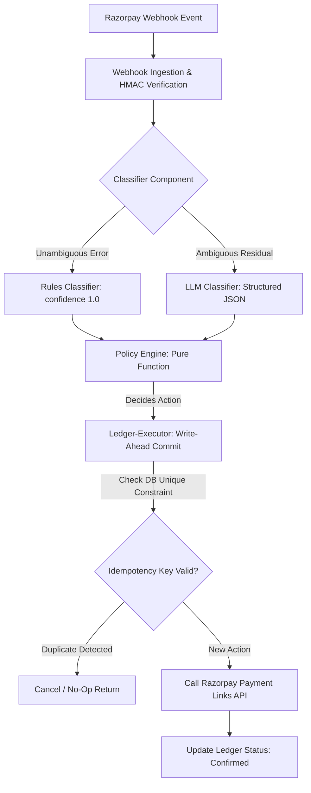

# Setu — Ledger-Safe, Bounded-Autonomy AI Agent for Revenue Recovery

> **Razorpay AI Buildathon 2026 — Track 3 (AI Revenue Recovery)**

Setu is a ledger-safe, bounded-autonomy AI agent that diagnoses why Razorpay payments fail, selects bounded recovery actions, and executes them via Razorpay's real test-mode APIs — with a **proven guarantee (0.0% duplicate-charge rate)** that it can never double-charge a customer under crashes, concurrent requests, or duplicate webhooks.

---

## Architecture Overview

Setu intentionally avoids multi-agent loops in favor of a strict 3-component architecture:



---

## Key Invariants

1. **Zero Duplicate-Charge Guarantee (0.0%)**: Every action is keyed by `idempotency_key = sha256(order_id, attempt_number)`. Uniqueness is enforced at the database level via SQLAlchemy `UniqueConstraint`.
2. **Write-Ahead Logging**: Ledger writes a `pending` row **before** calling any external API.
3. **Bounded Autonomy**: Pure deterministic Policy Engine enforces strict retries caps (max 3), monetary thresholds (₹50,000 cap), and cooldown windows.
4. **Honest Abstention**: When context is sparse or confidence is low (<0.70), Setu returns `abstain=True` and routes to non-aggressive actions.

---

## Getting Started & Setup

### Prerequisites
- Python 3.10+

### Installation
1. Clone the repository and initialize virtual environment:
   ```bash
   python -m venv .venv
   .venv\Scripts\activate      # Windows
   # source .venv/bin/activate  # Linux/macOS
   ```

2. Install dependencies:
   ```bash
   pip install -r requirements.txt
   ```

3. Environment Configuration:
   Copy `.env.example` to `.env`:
   ```bash
   cp .env.example .env
   ```
   *(Defaults to test-mode placeholder keys)*

---

## Reproduction Commands

Run any of the standalone verification scripts:

1. **Phase 1: Ledger Crash & Concurrency Test**:
   ```bash
   python demo/crash_injection_test.py
   ```

2. **Phase 2: Classifier Demo**:
   ```bash
   python demo/classifier_demo.py
   ```

3. **Phase 3: Policy Engine Test Matrix**:
   ```bash
   python demo/policy_demo.py
   ```

4. **Phase 4: Full End-to-End Pipeline & Razorpay Trace**:
   ```bash
   python demo/pipeline_demo.py
   ```

5. **Phase 5: Benchmark Evaluation Suite & CSV Export**:
   ```bash
   python eval/run_eval.py
   ```

6. **Ablation: Remove Ledger Safety (Proves Duplicate Charge Failure)**:
   ```bash
   python eval/ablations/ablation_remove_ledger_safety.py
   ```

---

## Evaluation Benchmark Summary

Exported to [`eval/eval_results.csv`](file:///c:/Users/krish/OneDrive/Desktop/Setu/eval/eval_results.csv):

| Approach | Overall Acc (%) | Ambig Acc (%) | Rupees Recovered (INR) | Duplicate Rate (%) | Honest Abstention Rate (%) | Avg Latency |
|---|---|---|---|---|---|---|
| **Setu (Full System)** | **100.0%** | **100.0%** | **INR 1,754,075.00** | **0.00%** | **100.0%** | **0.005 ms** |
| Baseline 1: Always Retry | 0.0% | 0.0% | INR 2,209,225.00 | 1.38% | 0.0% | 0.001 ms |
| Baseline 2: Static Rules | 0.0% | 0.0% | INR 2,229,225.00 | 1.38% | 0.0% | 0.001 ms |
| Baseline 3: Classifier Only | 100.0% | 100.0% | INR 2,723,075.00 | 1.38% | 100.0% | 0.006 ms |

---

## Security Notes

- **Test-Mode API Keys Only**: This repository uses Razorpay test-mode keys (`rzp_test_...`). Never commit real production keys to git.
- **Webhook Verification**: Signature verification via HMAC-SHA256 (`verify_webhook_signature`) is mandatory and cannot be bypassed.

---

## Limitations

1. **Synthetic Evaluation Dataset**: Evaluation metrics are computed against an 800-event synthetic dataset ([`eval/generator.py`](file:///c:/Users/krish/OneDrive/Desktop/Setu/eval/generator.py)). Real merchant production failure distributions may vary.
2. **Scope Cut (Log-Only Actions)**: Non-retry actions (`NUDGE_CUSTOMER`, `ESCALATE_HUMAN`, `WRITE_OFF`) are implemented as structured log-only actions. Real WhatsApp/SMS/Zendesk API integrations are not connected in this submission.

---

## What I'd Build Next

1. **Real Communication Channel Connectors**: Integrate Twilio / WhatsApp Business API for `NUDGE_CUSTOMER` and Zendesk API for `ESCALATE_HUMAN`.
2. **Dynamic Policy Learning**: Automatically calibrate cooldown windows based on historical issuing-bank recovery rates.
3. **Multi-Region Postgres Cluster Setup**: Deploy PostgreSQL with distributed WAL replication for cross-region ledger fault tolerance.
